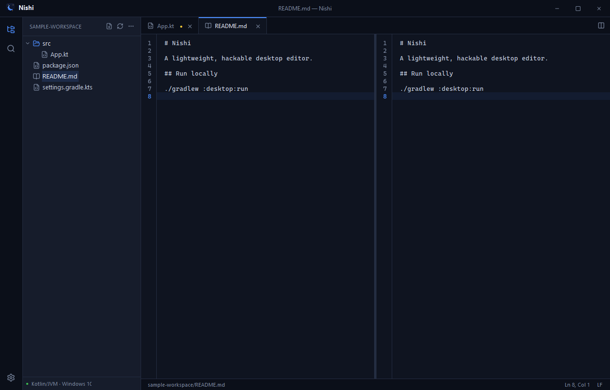

<div align="center">
  
  <h1>Nishi</h1>
  <p><em>nishi</em> — निशा / নিশি, <strong>night</strong></p>
  <p>An Atom-inspired desktop editor with a dark workbench and crash recovery for unsaved edits.</p>
</div>



## The transition to Kotlin

Nishi started as a TypeScript editor built on Bun and Electrobun. Development has moved to **Kotlin/JVM and Swing**. The rewrite keeps Nishi’s original icon, dark workbench, and split-pane editing while rebuilding the editor around separate document, filesystem, and desktop modules. The [v0.3.1 source](https://github.com/AurielSolaris/Nishi/tree/c27f6785973c2a5c3f89e7b268d39f9ae6cabecc) remains available in Git history.

The Kotlin build is in early development. Windows is the tested platform. Syntax highlighting, file watching, and idle buffer eviction are still ahead. Extensions, Lua, and the integrated terminal also remain planned.

## What works

- **Editing** · Open a workspace folder, browse files, and edit UTF-8 text. Split a document into two views with independent carets and shared text and undo history.
- **Find and replace** · Search with case matching, whole-word matching, or regular expressions. Replace all matches in one undo step.
- **Safer saves** · Tabs keep their original workspace when you open another folder. Nishi checks for external changes before replacing a file, and preserves its line-ending style and UTF-8 BOM.
- **Draft recovery** · Unsaved edits are journaled under `~/.nishi/kotlin-journal/` and reopened as drafts on the next launch. Files with disk conflicts are marked in the tab strip.
- **Editor controls** · Adjust font size, tab width, wrapping, line numbers, and current-line highlighting from the settings panel. These settings apply to the current session.

## Run from source

Install a JDK. The build targets Java 17 and has been verified with JDK 25. The checked-in Gradle wrapper manages the build.

**Windows**

```powershell
.\gradlew.bat :desktop:run
```

**macOS and Linux**

```sh
./gradlew :desktop:run
```

Choose **Open a folder…** in the explorer, then click a file to edit it. The split button sits at the right of the tab strip. Click the **Nishi** wordmark for the command menu, including **Save to New File**.

| Shortcut on Windows | Action |
| --- | --- |
| `Ctrl+O` | Open folder |
| `Ctrl+N` / `Ctrl+S` | New buffer / save |
| `Ctrl+F` / `Ctrl+H` | Find / replace |
| `Ctrl+\` | Toggle split view |
| `Ctrl+B` / `Ctrl+,` | Toggle explorer / editor settings |

## Project layout

| Module | Responsibility |
| --- | --- |
| [`editor-core`](editor-core/) | Document revisions, immutable snapshots, and text format |
| [`workspace-io`](workspace-io/) | Workspace-relative paths, conflict-aware saves, and draft persistence |
| [`desktop`](desktop/) | Swing workbench, editor views, commands, and application packaging |

Run `./gradlew check` for the regression suite or `./gradlew :desktop:installDist` to build a local desktop distribution. On Windows, use `.\gradlew.bat` for either command. The installed distribution is under `desktop/build/install/desktop/`.

## License

Nishi uses the same component-based licensing as the TypeScript release. The core application and build infrastructure are [Apache-2.0](LICENSE). Nishi-maintained extensions, themes, documentation examples, templates, and sample projects are [MIT](LICENSE-MIT). Third-party dependencies and assets retain their upstream licenses. [Project notice](NOTICE.md) · [Third-party licenses](THIRD_PARTY_LICENSE.md)
