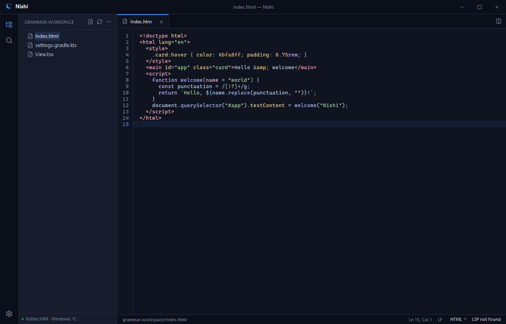

# Your code deserves an editor. *Not a browser.*

Nishi is an Atom-inspired desktop code editor built with Kotlin/JVM, with TextMate syntax highlighting and crash recovery for unsaved edits.

[Run from source](/download/)
[Read the docs](/docs/)

[View the full-size workbench screenshot](https://github.com/AurielSolaris/Nishi/blob/main/docs/workbench.png)

## The Kotlin workbench

Split a buffer and edit it from two independent views. Search and replace with regular expressions, switch syntax modes per tab, and pick up unsaved edits from local drafts after a restart.

[Explore the available editor features](/features/) or see [what’s planned](/roadmap/).
